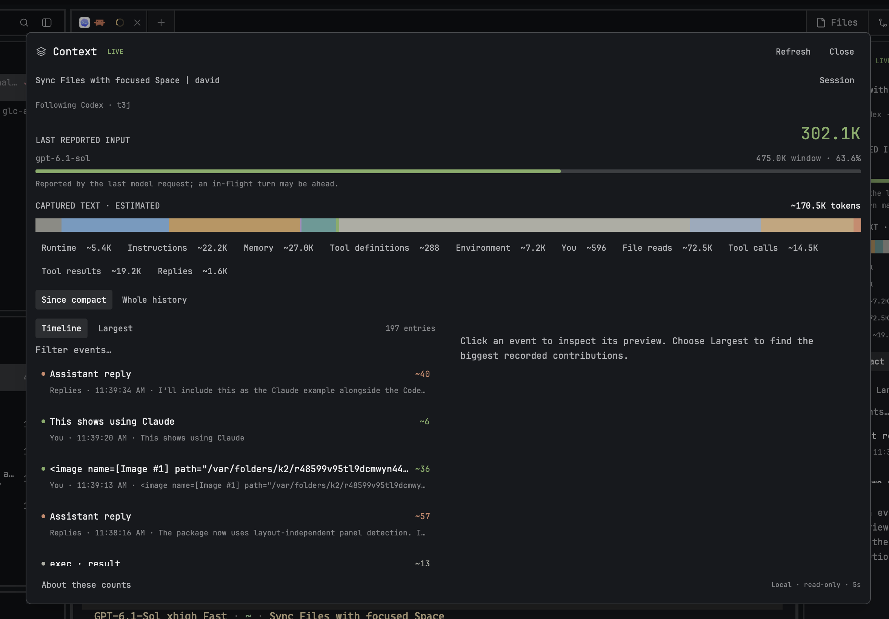
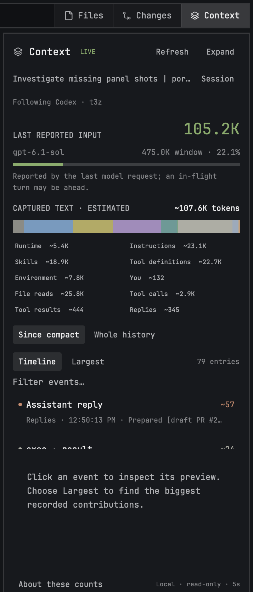
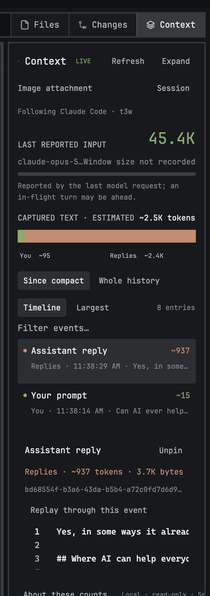

# Herdr Context Facey

See what is filling your AI session's context, right inside [Herdr](https://herdr.dev/).
A native inspector for **Codex**, **Claude Code**, **Grok Build**, and
**Antigravity CLI (`agy`)**, with a timeline, category
filters, pinned previews, and historical replay.



## Install

**Run this in your agent:**

```text
Read ~/.config/herdr-app/AGENTS.md, then add this mod: https://github.com/no-complect/herdr-context-facey
```

Requires the Herdr desktop app and **Python 3.9+** available as `python3`.
Tested on macOS. Adds a mod to your existing layout; Tuuxic is optional.
No API keys, hooks, or extra services are needed.

## Use it

Focus a supported agent terminal, then open **Context**. It refreshes every
five seconds. Use **Session** if automatic matching needs a hand.

| Control                       | What it does                                    |
| ----------------------------- | ----------------------------------------------- |
| Category labels               | Filter the recorded contributions               |
| Timeline / Largest            | Browse recent activity or the biggest entries   |
| Click an event                | Pin its text preview and source location        |
| Replay through this event     | Inspect captured history up to that point       |
| Since compact / Whole history | Compare the latest segment with earlier records |
| Expand                        | Open a larger view                              |

**Ctrl + Command + X** toggles the expanded dialog for the current Context
session. **Alt + Command + X** is an optional alias; an embedded panel uses its
layout's controls. Merge the supplied `keys.json` snippet only
where the shortcut is available. [Manual installation and layout setup](docs/INSTALL.md).

## Understand the numbers

**Last reported input** comes from the provider's latest recorded request.
Grok instead shows **Context estimate**, its own saved context
counter, which can include estimates.
**Captured text** is an estimate using UTF-8 bytes divided by four. The two
numbers measure different things and can differ substantially.

Claude and Antigravity group file reads under Tool results and do not separately
account for startup instructions, memory, or skills. Antigravity requires a
generated `transcript.jsonl`; older database-only conversations are unsupported.
Grok reads the retained chat history, which can be replaced by compaction or rewind;
earlier usage replay and tool definitions outside that history are unavailable.
Hidden reasoning and opaque
summaries are excluded from text estimates. Default local session storage only;
remote sessions and custom storage directories are unsupported.

The mod reads local history without changing it or making network requests.
Previews can contain private conversation text; review screenshots before sharing.
[Accounting, compatibility, and privacy details](docs/ACCOUNTING.md).

## Screenshots

**Codex panel**



**Claude Code panel**



## Contribute

Issues, improvements, and forks are welcome. To check a change:

```sh
npm ci
npm test
python3 -m unittest discover -s tests -v
herdr-app check mods/herdr-context-facey
```

JavaScript, JSON, and Markdown use Prettier; Python uses Ruff. See
[CONTRIBUTING.md](CONTRIBUTING.md) for formatting commands and live checks.
[Architecture and reader protocol](docs/ARCHITECTURE.md) explains the controller,
provider adapters, and regression-test boundaries.
[RECIPE.md](RECIPE.md) describes how the mod works and how to rebuild it.

## License

[MIT](LICENSE). Use, modify, fork, and redistribute it, including commercially;
keep the copyright and license notice with your copy.
