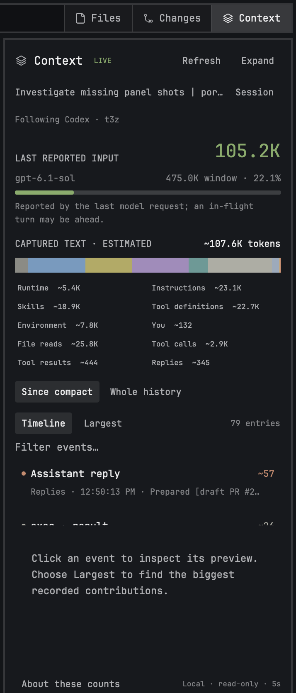
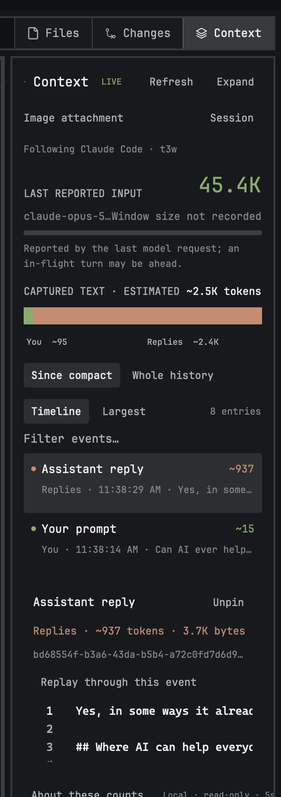
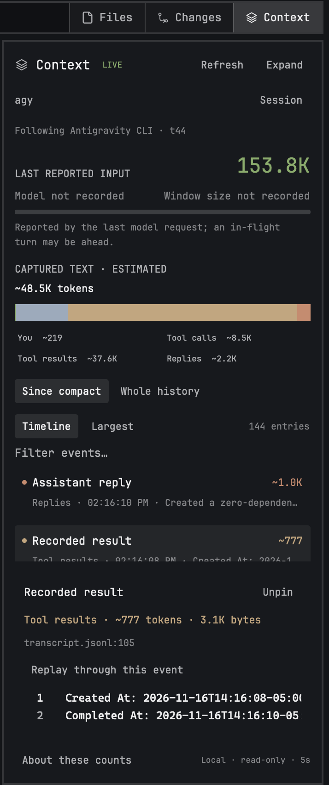
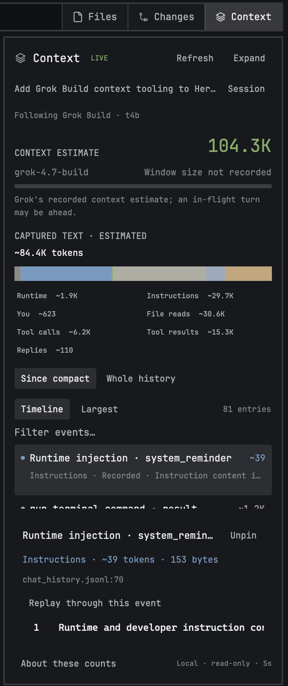

# Herdr Context Facey

Context mapping for **Codex**, **Claude Code**, **Grok Build**, and
**Antigravity CLI (`agy`, also called Gemini AGY)**, inside Herdr. The native
panel follows the selected local agent and maps its recorded context into an
estimated category breakdown and event timeline. Search and Largest identify
large contributions; clicking an event pins its source preview. Provider-recorded
usage or context estimates appear separately, with historical replay where the
saved records support it.

|                                                         Codex                                                          |                                                          Claude Code                                                           |                                                       AGY (Antigravity CLI)                                                        |                                                        Grok Build                                                         |
| :--------------------------------------------------------------------------------------------------------------------: | :----------------------------------------------------------------------------------------------------------------------------: | :--------------------------------------------------------------------------------------------------------------------------------: | :-----------------------------------------------------------------------------------------------------------------------: |
|  |  |  |  |

## What you see

Use the current Herdr theme for the background, surface, foreground, muted text,
borders, selection and hover colors. A compact header has a layers icon,
**Context**, a green **LIVE** or amber **REPLAY** badge, Refresh and Expand.
Below it, show the terminal title, Session picker control, provider and terminal
address. Avoid overlapping model names and window-capacity labels in narrow
panels. Initial width is 450 logical pixels; an expanded dialog is 1120 by 760.

The next region shows **LAST REPORTED INPUT** for Codex, Claude Code and AGY, or
**CONTEXT ESTIMATE** for Grok Build. Show the latest recorded count in large
type, model name and, if actually recorded, window capacity and percentage. A
thin gauge is green, amber from 75%, red from 90%. Say that it can lag an
in-flight turn. Missing usage or capacity stays visibly unknown.

Below that is **CAPTURED TEXT · ESTIMATED**, its separate approximate total,
and a colored proportional bar. Categories use these stable colors: Runtime
`#8b8b84`, Instructions `#709bc1`, Memory `#bd945d`, Skills `#b4aa5d`, Tool
definitions `#a48bbd`, Environment `#619a96`, You `#82ac65`, File reads `#adada3`,
Tool calls `#9aabbd`, Tool results `#c7a57a`, Replies `#ce896b`, Compaction
`#d4a75c`. Hide empty categories. Use two compact legend columns below 400px.

Where compaction boundaries are recorded, controls select Since compact or
Whole history. Grok and AGY show Recorded history. Timeline/Largest tabs and a
search input sit above a scrolling, virtualized list of 63px rows. Each row
shows a category dot, label, approximate tokens, timestamp and short teaser.
The pinned preview shows label, category, estimated tokens, text bytes and source
file/line. It includes Unpin, Replay through this event and a read-only text
editor. Above 720px, list and preview fill equal-width columns; below that,
stack them vertically. Stretch both columns so the virtual list gets a real
height. The bottom has About these counts and Local / read-only / 5s.

## How it behaves

All agent statuses use the same accounting display. A working agent refreshes
as records become available; an idle, done or blocked agent keeps its recorded
data. Status does not manufacture usage. Follow the focused Codex, Claude Code,
Grok Build or AGY terminal. For a shell or inspector focus, prefer the selected agent in the same
tab, then an unambiguous working/sole supported agent. Retain a previous target
only within the same space and tab. Clear old data and previews on target changes.

Poll every five seconds while visible. Hidden ancestors or inactive stack
children pause polling. Dialogs read while open; pane mounts account for the
selected tab and zoom. A Session picker handles ambiguous identities. Folder and
recency alone never pick a conversation. Manual attachment is per copy and can
return to automatic following.

Click a category to filter it, click again or Show all categories to clear.
Search labels and teasers; Largest sorts by estimated tokens. Clicking a row
pins its preview. Hover changes color only.

Replay filters evidence to the selected event and uses the latest usage sample
available by then. Since compact keeps the newest recorded segment plus latest
persistent snapshots; Whole history shows all retained events. Grok has only its
retained snapshot and latest context estimate; earlier usage replay is unavailable.
AGY does not record explicit compaction boundaries. Back to live
resumes the latest view. Refresh re-reads immediately. Expand pins the current
target into a larger dialog. Close, Escape or its toggle shortcut dismisses it.
Ctrl + Command + X opens and closes this dialog, inheriting the current panel's
selected session. Alt + Command + X is an optional dialog shortcut too; a host
layout can instead assign it to opening and closing the embedded side panel.

## Built from

One mod at `mods/herdr-context-facey/`:

- `main.js`: GPUI `View` using `div`, `svg`, `uniform_list`, `h_flex`, `v_flex`,
  native `InputState`/`Input`, `EditorState`/`Editor`, and `Scrollbar`.
- `session-controller.js`: request ordering, selected session snapshots, pinned
  previews and replay state, independently of native UI handles.
- `reader-client.js`: Python subprocess invocation and versioned JSON validation.
- `model.js`: category palette, formatting, totals, compaction slicing and
  historical usage lookup. Pure JavaScript.
- `target.js`: pure session selection from focus, panes and terminals; keeps
  retained targets inside their original space and tab.
- `visibility.js`: traverse arbitrary layout IDs, respecting `hidden` and active
  stacks. Optional `props.blockId` distinguishes multiple layout copies.
- `inspect_session.py`: standard-library-only read-only Python 3.9+ CLI.
- `reader/`: shared protocol, safe file access and accounting; separate Codex,
  Claude Code, Grok Build and AGY adapters own discovery, parsing and previews.
- `context.svg`: a small layers outline icon.
- `mod.json`: `place: none`, title Context, overlay size 1120 by 760.

The virtual list uses one `on_item_click` handler outside its row renderer.
Expanded copies accept `props.target` and `props.selectedPath`. A dialog opened
through the app's native toggle inherits these from the live panel, when present,
through a module-local reference cleared when that panel closes. Store no
attachment in shared or persistent state.

Use Herdr's `appHome`, `exec`, `focused`, `panes`, `terminals`, `layout`, `props`,
`theme`, `settings`, `openOverlay` and `closeOverlay`. A current callback receives
its own `cx`; never store one for a later callback. Launch Python with a program
and argument array, not shell interpolation. `cx.spawn` awaits it; the timer uses
`cx.timer.every`. Request generations reject stale responses after target changes
or closing. Verify a source record's fingerprint before previewing it; preserve
valid pinned records on append and clear replaced records or changed sessions.

Match sessions by explicit identity, foreground open file, Claude's optional
process mapping, or an unambiguous Codex name/recorded continuation. Otherwise
show the picker. Resolve transcript paths inside each provider's approved default
local storage and accept only supported transcript paths. Open Codex's SQLite
index read-only. Grok uses retained `chat_history.jsonl`, its saved update counter
and known session metadata. AGY uses generated `transcript.jsonl` files in either
default Antigravity app-data directory. Match Grok's event-writer/lock paths and
AGY's presence-lock paths without reading their contents. Never read provider
settings or authentication files for discovery.

Parse actual Codex response items, persistent snapshots and usage events. Ignore
mirrored event records and opaque reasoning. Follow recorded lineage only to
its explicit byte boundary. Parse saved replacement messages when present.
Claude reads user/assistant text, tool-use/results, usage and compact boundaries.
Grok reads ordinary retained messages and tool records, excludes private reasoning
and protects synthetic instruction injections. AGY reads generated user, planner
and result steps without double-counting mirrored full transcripts or thinking.
Count Codex cached input once; sum Claude's and AGY's separate input/cache buckets.
Label Grok's saved context counter as an estimate. UTF-8 bytes / 4 is an explicitly
approximate text estimate independent of those totals.

The optional root `keys.json` binds `cmd-ctrl-x` and `cmd-alt-x` to
`mod.open:herdr-context-facey`. Merge it only where available. An embedded block
can use any ID; its host layout supplies its own tab-bar button and open/close
action. Include no `layouts/` directory or whole user configuration. Copy no
session logs, authentication files, generated editor files or Python bytecode.

## Watch out

The displayed category bar is captured evidence, not the exact live prompt.
Media, opaque summaries, private reasoning and unrecorded runtime content can
explain a gap. Do not count fallback UI text as a summary's actual tokens.
Claude and AGY do not separately record startup instructions, memory or skills;
file reads are Tool results. AGY model/window capacity and compaction boundaries
remain unknown. Grok's retained history can be replaced by compaction or rewind,
and external tool definitions are not counted. Older database-only AGY sessions
and legacy Gemini CLI are unsupported. No subagent aggregation is implemented.

The reader runs no provider requests, network calls or hooks, reads no auth files
or process environments, and writes no session text. Preview ordinary text on
demand, suppress runtime/developer/tool-definition bodies and opaque reasoning,
and redact common credentials on a best-effort basis. Previews may still be
private; screenshots need review before sharing.

Read limits: 96 MiB, 16 MiB per record, 16 history files, 5,000 retained events,
2,000 usage samples, and 24,000 characters per preview. Report partial data. Use
only the latest persistent snapshot for a given key in Since compact. Incomplete
trailing writes are skipped and retried. Default local storage for the four supported agents only;
custom storage and remote sessions are unsupported. `lsof` is an optional match
source. macOS has live checks; Linux/Windows do not. Log formats can change.

## Done when

1. Herdr's native mod check passes; no layout or mod errors appear live.
2. Each of the four supported local agents shows its own captured-text mapping,
   with recorded usage or estimates kept separate from category totals.
3. Two focused agents switch the inspected session without showing stale data.
4. Search, category filters, Largest, pinned previews and replay work in narrow
   and expanded views. Expanding requires no Tuuxic-specific IDs.
5. Recorded compaction boundaries change the visible segment and preserve Whole
   history access; unavailable provider history is clearly identified.
6. A synthetic fork test excludes later parent-branch records; cached input is
   counted once, mirrored records are ignored, opaque reasoning stays excluded,
   and protected/out-of-root previews stay blocked.
7. Hidden/inactive layout copies pause polling, using arbitrary node IDs.
8. The published tree contains the recipe, runtime files, optional key snippet,
   license, safe screenshots and tests, with no private session data.
